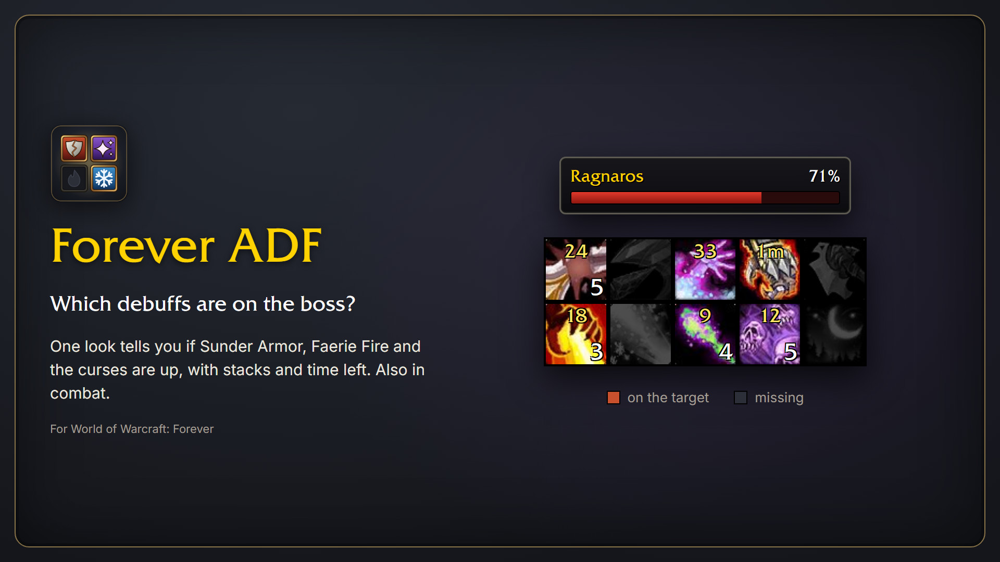

# Forever ADF

Forever ADF is a port of [aDF](https://turtle-wow.fandom.com/wiki/ADF), the armor and debuff frame that raids on Turtle WoW use to see whether Sunder Armor and the curses are on the boss. This is the same idea for WoW Forever: a small grid of icons. An icon is lit while the debuff is on your target and dark while it is missing, and it shows the stacks and the time left.

It keeps working in combat, which on Forever is the hard part. More on that below.

## What it does

- One icon per debuff you care about. Lit means it is on the target, dark means somebody should put it up.
- Stacks and remaining time are on the icon, so you see Sunder Armor at 3 of 5 or a curse about to run out.
- If your target is friendly, the frame shows what that player is attacking. A healer who has the tank targeted sees the boss's debuffs.
- You choose which debuffs are tracked, how big the icons are and how many sit in a row. The frame can hide itself out of combat, outside of a group or without a target.
- Anything that is not in the list you add yourself by spell ID.
- English and German. The debuff names come from the game, so they are in your client's language either way.

## Debuffs in the list

Shown from the start: Sunder Armor, Expose Armor, Faerie Fire (caster and feral), Curse of Recklessness, Armor Shatter from Annihilator, Fire Vulnerability from Improved Scorch, Winter's Chill, Shadow Vulnerability from Improved Shadow Bolt and from Shadow Weaving, and Spell Vulnerability from Nightfall.

Switched off until you tick them: the three paladin judgements, Demoralizing Shout, Demoralizing Roar, Thunder Clap, Hunter's Mark, Curse of Weakness and Curse of Tongues.

## Using it

Type `/adf` for the options. To move the frame, hold Shift and drag it.

| Command | What it does |
| --- | --- |
| `/adf` | Open the options |
| `/adf show` | Show the frame |
| `/adf hide` | Hide the frame |
| `/adf lock` | Lock or unlock the position |
| `/adf reset` | Put the frame back where it started |

To remove a debuff you added yourself, right-click it in the options. Settings are saved per character.

## What aDF had and this does not

If you know aDF from Turtle WoW you will miss two things. I tried both and took them out again, because the Forever client does not allow them.

The first is the armor number, and the resistances with it. Ask the Forever client for an enemy's armor and it answers 0, for every mob. The old 1.12 client told addons the real value.

The second is announcing debuffs in chat. While you are in combat, Forever lets addons read nothing about a unit's debuffs. The game can still draw them, and that is how the icons work: the addon tells the game which spell belongs in which slot and the game fills it in. The addon itself never finds out which slots are lit, so it has nothing to announce.

Curse of the Elements, Curse of Shadow and Ignite are not in the list either. Their vanilla spell IDs do not exist in the Forever client. If you find them under other IDs, add them as your own debuffs.

## Installing by hand

Copy the folder into `World of Warcraft/_forever_/Interface/AddOns/` and name it `ForeverADF`.

## Credits and the original

All credit for the idea goes to aDF and the people who built it:

- Atreyyo wrote the original aDF for the 1.12 client (Vanillagaming.org).
- Zebouski maintained it for Turtle WoW, with contributions by Goffauxs: [github.com/Zebouski/aDF](https://github.com/Zebouski/aDF) (branch `masterturtle`).
- Autignem rewrote it as version 4, which is the one Turtle WoW players use today: [github.com/Autignem/aDF](https://github.com/Autignem/aDF).
- The Turtle WoW wiki has a page on it: [turtle-wow.fandom.com/wiki/ADF](https://turtle-wow.fandom.com/wiki/ADF).

Forever ADF takes the idea and the look from them. The code is new, because the Forever client shares almost nothing with 1.12. How to show debuffs in combat I learned from reading [Platynator](https://www.curseforge.com/wow/addons/platynator).

If you play on Turtle WoW, you want the original, not this.

## License

GPL-3.0-or-later, see [LICENSE](LICENSE).
