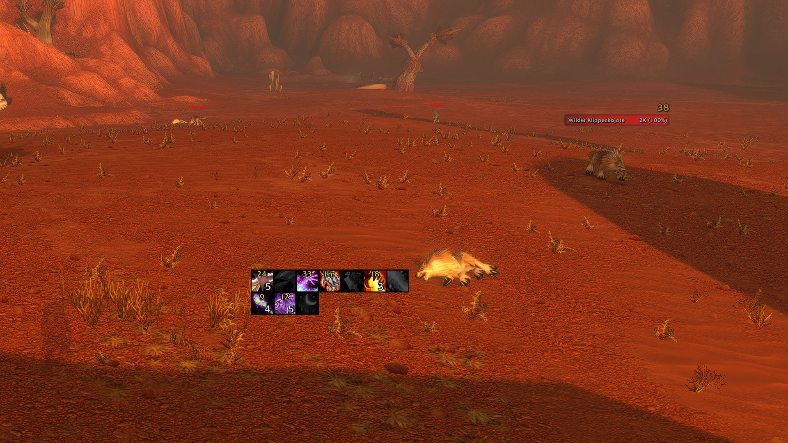
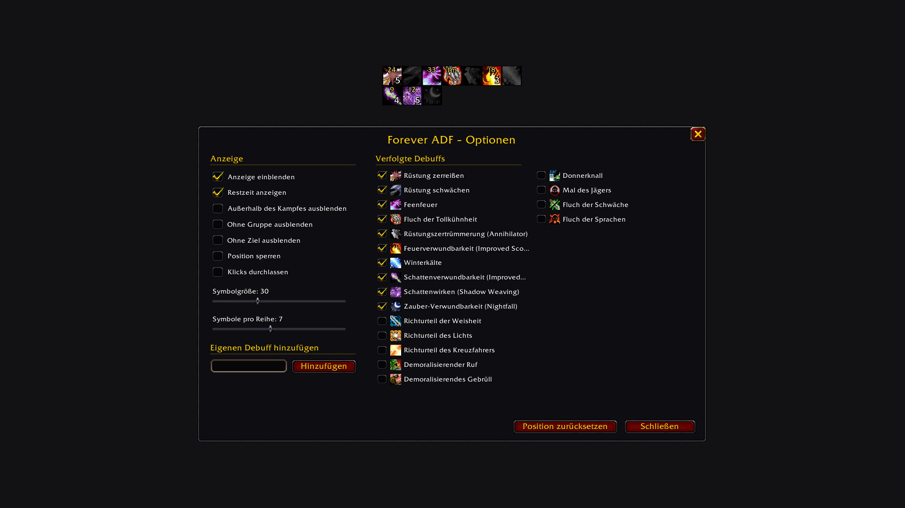

# Forever ADF

A port of [aDF](https://turtle-wow.fandom.com/wiki/ADF) for WoW Forever. aDF is the debuff frame raids on Turtle WoW use to see whether Sunder Armor and the curses are on the boss.

It is a small grid of icons. An icon is lit while the debuff is on your target and dark while it is missing, and it shows the stacks and the time left. It keeps working in combat.

## What it does

- If your target is friendly, the frame shows what that player is attacking. A healer who has the tank targeted sees the boss's debuffs.
- You pick which debuffs are tracked, how big the icons are and how many sit in a row. Anything that isn't in the list you add by spell ID.
- The frame can hide itself out of combat, outside of a group or without a target.

Type `/adf` for the options. To move the frame, hold Shift and drag it. `/adf show`, `/adf hide`, `/adf lock` and `/adf reset` do what they say.

## Debuffs in the list

| Default | Debuffs |
| --- | --- |
| On | Sunder Armor, Expose Armor, Faerie Fire (caster and feral), Curse of Recklessness, Armor Shatter (Annihilator), Fire Vulnerability (Improved Scorch), Winter's Chill, Shadow Vulnerability (Improved Shadow Bolt and Shadow Weaving), Spell Vulnerability (Nightfall) |
| Off until you tick them | The three paladin judgements, Demoralizing Shout, Demoralizing Roar, Thunder Clap, Hunter's Mark, Curse of Weakness, Curse of Tongues |

## What aDF had and this does not

I tried these and took them out again, because the Forever client doesn't allow them:

- The armor number and the resistances. Ask Forever for an enemy's armor and it answers 0, for every mob.
- Announcing debuffs in chat. In combat, addons can't read a unit's debuffs. The game draws the icons itself, so the addon never finds out which ones are lit.
- Curse of the Elements, Curse of Shadow and Ignite. Their vanilla spell IDs don't exist in Forever. If you find them under other IDs, add them as your own debuffs.

## Credits

The idea and the look come from aDF. Atreyyo wrote the original for the 1.12 client, [Zebouski](https://github.com/Zebouski/aDF) maintained it for Turtle WoW with contributions by Goffauxs, and [Autignem](https://github.com/Autignem/aDF) rewrote it as version 4, the one Turtle WoW players use today. The code here is new, and how to show debuffs in combat I learned from reading [Platynator](https://www.curseforge.com/wow/addons/platynator).

If you play on Turtle WoW, you want the original, not this.

## About me

I'm Sven. I've been a software developer for over 20 years, and I write and maintain my World of Warcraft addons in my free time. They are free and open source, and they will stay that way.

Found a bug or have an idea? Open an [issue](https://github.com/svengabr/ForeverADF/issues) or send me a DM on [CurseForge](https://www.curseforge.com/members/conoar).

## License

GPL-3.0-or-later
